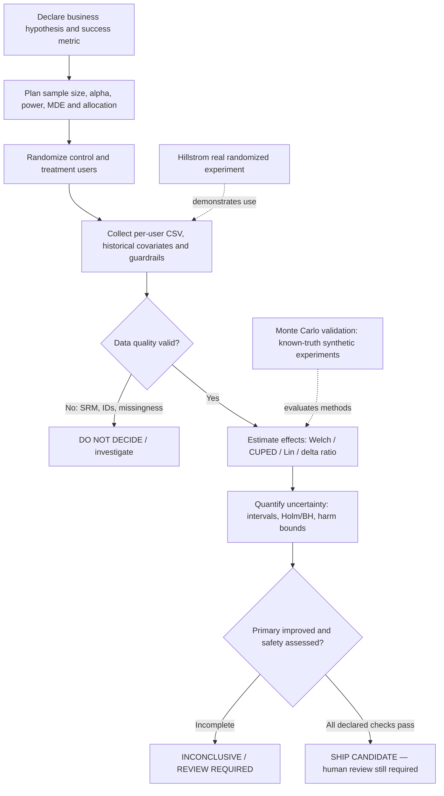
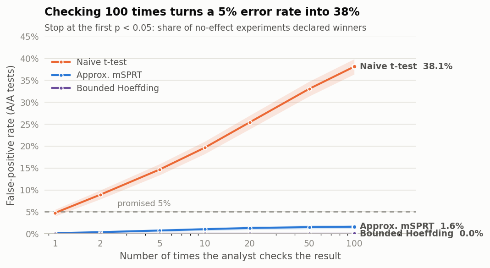
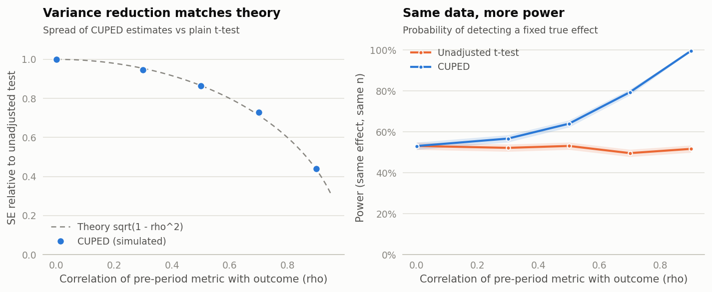
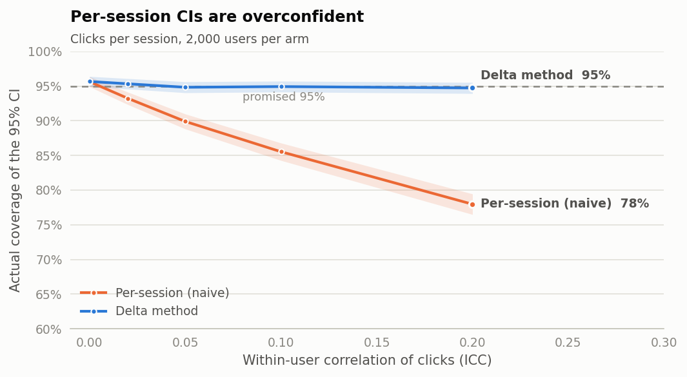
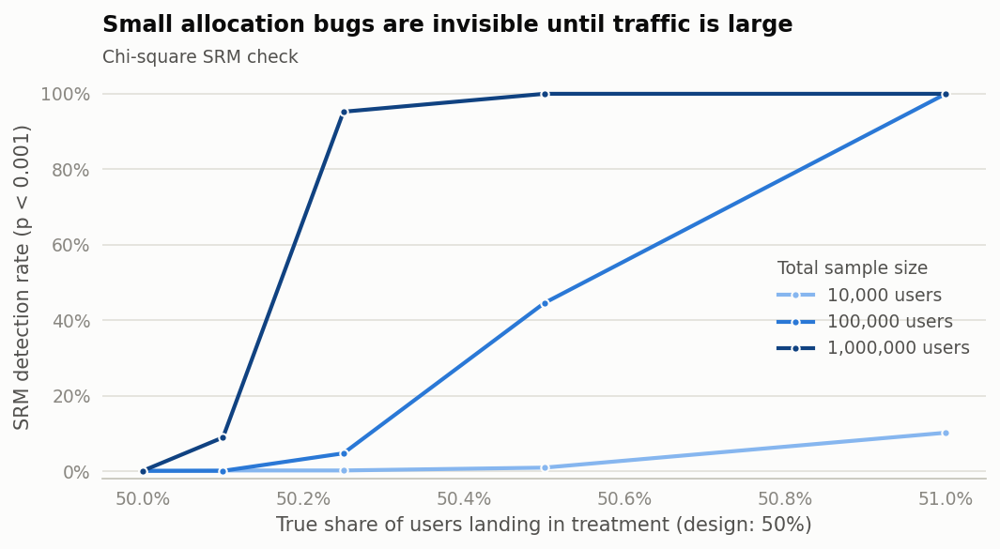
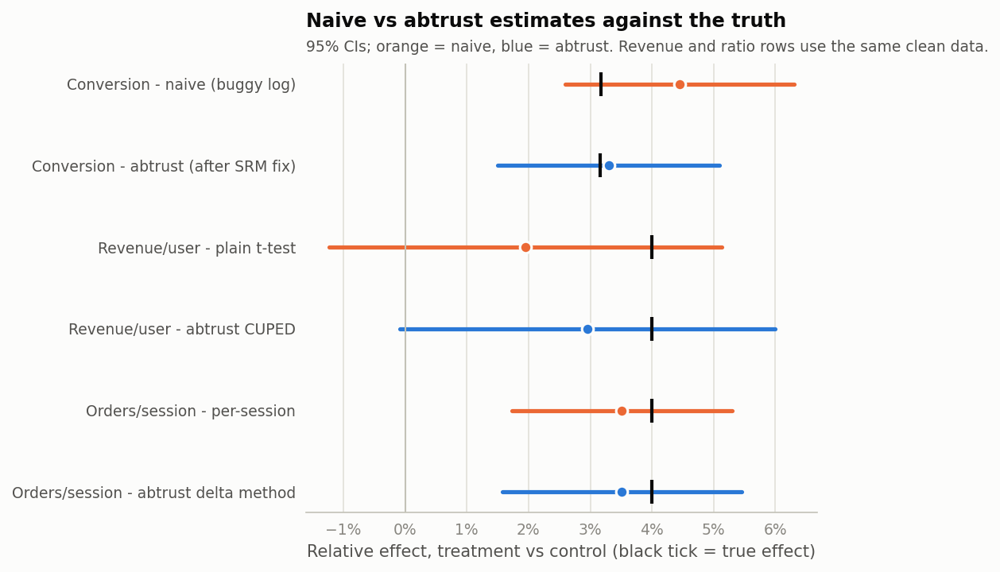
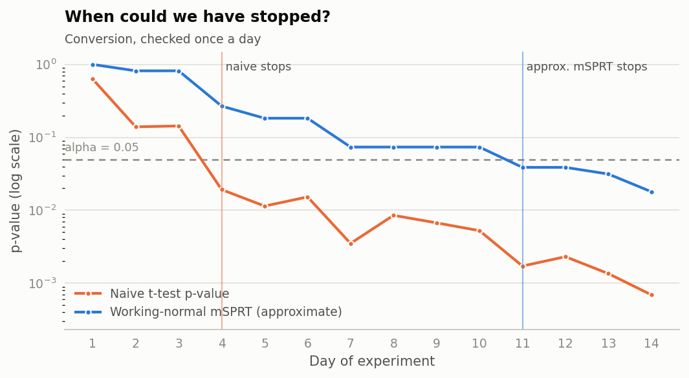

# abtrust — Complete Project Context, Technical Handoff and Research Report

> **Current verification — 19 October 2026:** This supersedes older status notes below. A fresh Windows environment passed **122 tests including real Streamlit AppTest** (default: **121 passed, 1 intentionally skipped**) and Ruff. All seven full-budget core studies, two supplemental stress studies (2,000 replications per cell), the synthetic checkout and cached real Hillstrom analysis completed. Saved CSVs/manifests can be rendered without mutation; provenance now records seeds, parameters, input hashes and source/runtime details. Browser uploads verified the synthetic 20/80 allocation, duplicate-ID rejection and malformed one-column rejection; other upload edge cases remain automated-only. The rare-binary stress case exposed only **84.75% coverage** for a nominal 95% interval, an explicit limitation rather than a passing accuracy claim. Git now exists at baseline `2f959bd`; remote CI has not been run. Read `docs/RELEASE_VERIFICATION.md`, `docs/REPRODUCIBILITY.md` and `docs/LEARNING_AND_DEMO.md` for current evidence and commands.

> **Post-review update — 18 October 2026:** The current Windows checkout passes **88 tests with the real Streamlit AppTest enabled**, plus Ruff. All seven full-budget studies, both application reports, figures and CLI examples were rerun after correcting bounded monitoring schedules, planner validation, confidence labels, replication counts and simulated-case unit-ID checks. Corrected bounded power at twice the MDE is **78.8% with one look** versus **0.23% with 100 looks**; earlier broad statements about near-zero bounded power apply to the many-look setting. The 83-passed/1-skipped and offline-only verification statements below are historical. Browser checks now cover the sample readout, invalid inputs, planner recovery, peeking modes and actual Markdown download; browser CSV upload remains unverified because the automation file chooser timed out. Read the current `docs/RELEASE_VERIFICATION.md` and generated reports before relying on older status descriptions. The statistical safety and simulation-versus-real-data qualifications below still apply.

> **Read this first if you are Claude Code or another coding agent.** This document is a knowledge-transfer file for a real local Python repository called `abtrust`. The user is learning the fundamentals from scratch and wants a rigorous, well-explained portfolio project. The document contains verified source-derived facts, prior execution results, research explanations with author–year citations, accurate commands, and specific warnings. **Do not treat this document as the repository's current code:** inspect actual files before edits or claims. **Do not claim simulated findings are real-world outcomes.**
>
> **No extra cloud compute or GPU is needed.** The user's Windows laptop uses Python 3.10.x, 16 GB RAM, and a Ryzen 7 CPU. Earlier RTX 3050 details are irrelevant to this CPU-oriented project.

## 0. Claude Code / coding-agent operating brief

### User intention

The user is a computer-science undergraduate developing a demonstrable data-science portfolio. They originally extracted the project and ran `scripts/case_study.py` directly, encountering `ModuleNotFoundError: No module named 'abtrust'`. After setting up a virtual environment, they successfully ran the tests, Monte Carlo simulations and Streamlit app. They have expressly said that they followed the commands **without initially understanding what A/B testing, statistical power or the methods meant**. Their priority is therefore **learning and correctness, not simply adding more algorithms**.

The requested output in earlier turns was an academic report formatted similarly to their unrelated Bangladesh electricity-demand paper, with **citations, in-text citations, authentic result plots, readable diagrams, equations and explanations from first principles**. This file is the portable Markdown equivalent *plus* the coding-agent handoff, so another assistant can continue without relying on the previous conversation.

### Read-before-edit source precedence

1. **The actual current source files on disk** are definitive for code behavior; inspect them and `git status` before editing.
2. The repository's generated `reports/*.md`, raw `reports/validation/*.csv`, `docs/methods.md`, `README.md`, and test files establish what this version documents and measures.
3. This handoff is a contextual explanation and can lag behind later user changes.
4. External papers cited in the References section justify established methods, not the correctness of this particular implementation.
5. A **simulation** may empirically support calibration under tested assumptions; it cannot establish a theorem or general production certification.

### Quick status based on user-shared Windows screenshots (17 October 2026)

| Check | Observed evidence | Interpretation |
|---|---|---|
| Package | `abtrust --version` → `abtrust 0.3.0` | Installed |
| Environment | `(.venv_v03) PS D:\Programming\abtrust>` | Active Python virtual environment |
| Python | Python 3.10.11 | Working interpreter |
| Ruff | `ruff check .` → `All checks passed!` after one import sorting fix | Lint succeeded |
| Core tests | `python -m pytest` → **83 passed, 1 skipped** | All executed tests succeeded |
| Optional Streamlit test | `tests/test_streamlit_integration.py` explicitly skipped unless an environment variable is set | Not yet independently confirmed passing on user's Windows machine |
| Streamlit server | Started successfully at **`http://localhost:8502`** before being stopped | Server starts; full interactive browser acceptance unconfirmed |
| Validation | Seven Monte Carlo studies ran to completion in v0.3 | Source-specific outputs in `reports/validation.md` |
| Real data | Hillstrom run completed, generated report `REVIEW REQUIRED` | Not a safety-cleared ship decision |

The user also encountered Windows virtual-environment problems: permission denied when overwriting an existing `.venv` executable, and PowerShell blocking script activation. Their successful workaround was to create **`.venv_v03`** and temporarily allow scripts with `Set-ExecutionPolicy -Scope Process -ExecutionPolicy Bypass`. Do **not** tell them to overwrite or copy an active/locked environment.

### What Claude Code should do when asked to continue

- Open `README.md`, `pyproject.toml`, `docs/methods.md`, `src/abtrust/readout.py`, `src/abtrust/sequential.py`, and the user's target code before suggesting changes.
- Reproduce specific bug reports with an automated test; modify the smallest necessary surface; rerun lint and tests.
- Preserve conservative guardrail decisions and the labels distinguishing sequential validity assumptions.
- Re-run simulations/reports **only when underlying estimators, scenarios, assumptions, presentation or data change**; do not silently overwrite authoritative results with a reduced-scale trial.
- Explain every technical edit in beginner-friendly language: **what problem it fixes, how it works, how to test it**, and what the new output means.
- Treat the checkout experiment as **simulated**, and the Hillstrom experiment as **real experimental data**.
- Never claim a nonsignificant regression demonstrates safety, that an SRM pass proves perfect logging, or that the working-normal mSPRT is universally anytime-valid.
- Before publishing: run `ruff check .`, `python -m pytest`, optional AppTest, Streamlit browser acceptance, and review generated reports and license/README.
- Do not add `.venv`, `.venv_v03`, `.git`, `__pycache__`, `.pytest_cache`, `.ruff_cache` or cached Hillstrom CSV to a release ZIP/commit.
- Ask about the *desired next change* when the user gives no specific modification; do not invent scope or silently alter research conclusions.

### High-level pipeline (Mermaid; readable as text too)



### What abtrust is — one paragraph

`abtrust` is a Python library, CLI tool and Streamlit dashboard for **A/B testing**. It checks whether an observed control-vs-treatment difference could be misleading due to random variation, broken allocation/logging, correlated measurements, multiple tests or unsafe outcomes. It integrates established methods (Welch, SRM, CUPED, Lin regression, ratio delta method, Holm/BH, and conditionally valid sequential analysis) with a **seven-study simulation validation suite**, a **200,000-user synthetic checkout case study**, and the **real Hillstrom 64,000-customer email experiment**. It is **not** a gradient-boosted machine learning project. Its so-called power/precision “boost” comes primarily from **CUPED variance reduction**, not XGBoost or neural networks (Deng et al., 2013; Kohavi et al., 2020).

---

## 1. Complete repository map and responsibilities

Place this Markdown file at `D:\Programming\abtrust\ABTRUST_COMPLETE_CONTEXT_FOR_CLAUDE_CODE.md` or give it directly to Claude Code alongside the code archive. Relative figure links below refer to this **repository root**.

```text
abtrust/
├── README.md                          # Project overview, evidence, caveats, usage
├── pyproject.toml                     # Python package/deps/pytest/Ruff/CLI entrypoint
├── LICENSE                            # MIT license
├── Makefile                           # Development task shortcuts
├── .gitignore                         # Environment, cache and other exclusions
├── .github/workflows/ci.yml          # Code checks and optional app-smoke workflow
├── app/
│   └── streamlit_app.py               # Interactive tabs, inputs, result tables/plot
├── src/abtrust/
│   ├── __init__.py                    # Package exports and version
│   ├── app_support.py                 # CSV parsing, labels, allocation/margin validation
│   ├── checks.py                      # Chi-square SRM and segment diagnostics
│   ├── cli.py                         # `abtrust plan|analyze|validate` commands
│   ├── design.py                      # Sample-size / alpha / power / MDE planning
│   ├── estimators.py                  # Welch, CUPED, Lin HC2, delta ratios
│   ├── multiple.py                    # Holm and BH corrections
│   ├── plots.py                       # Experimental figure generation
│   ├── readout.py                     # Metric spec, analyze(), validation gates, decision()
│   ├── report.py                      # Writes simulation reports and figures
│   ├── sequential.py                  # Working-normal, bounded, Gaussian known-SD modes
│   ├── simulate.py                    # Synthetic experiment data generation
│   └── validation.py                  # Seven Monte Carlo studies
├── scripts/
│   ├── case_study.py                  # 200k-user simulated checkout traps & reports
│   └── hillstrom.py                   # Real MineThatData 64k-user email analysis
├── data/
│   └── sample_experiment.csv          # Bundled 40k-user simulated sample for dashboard
├── docs/
│   ├── methods.md                     # Method assumptions, math and references
│   ├── DASHBOARD_QA.md                # Manual acceptance checklist
│   └── RELEASE_VERIFICATION.md        # What was tested and what was not
├── tests/                              # 83 core tests + optional app integration test
├── reports/
│   ├── case_study.md                  # Simulation findings and narrative
│   ├── case_study_readout.md          # Detailed 17-comparison result table
│   ├── case_study.json                # Structured case-study outcome
│   ├── hillstrom.md                   # Real data: effects, pairwise, caveats
│   ├── validation.md                  # Complete Monte Carlo summary
│   ├── validation/*.csv               # Per-study reproducibility output
│   └── figures/*.png                  # Six published graphics
├── CHANGELOG-v0.2.md
├── CHANGELOG-v0.3.md
└── abtrust-run-guide-v0.3.md
```

The code can be run entirely on a Windows laptop. Internet is needed for initial dependency installation and, absent a cached file, for downloading the public Hillstrom dataset. **Do not assume `data/hillstrom.csv` exists in the lightweight ZIP**.

### Primary dependencies (from project package)

`numpy`, `scipy`, and `pandas` supply the numerical and tabular core; `matplotlib` is used for figures; `streamlit` supplies the dashboard; `pytest` supplies tests; `ruff` supplies linting. Verify exact version pins in `pyproject.toml` rather than inventing them.

## 2. Verified runbook for the user's Windows environment

### Existing successful environment

```powershell
cd D:\Programming\abtrust
.\.venv_v03\Scripts\Activate.ps1
abtrust --version
ruff check .
python -m pytest
```

The virtual environment must be recreated only if it is genuinely missing or broken. If activation is blocked in **this PowerShell process**, first run:

```powershell
Set-ExecutionPolicy -Scope Process -ExecutionPolicy Bypass
.\.venv_v03\Scripts\Activate.ps1
```

For a fresh install when an old `.venv` is locked, use a new folder instead of overwriting it:

```powershell
cd D:\Programming\abtrust
py -3.10 -m venv .venv_v03
Set-ExecutionPolicy -Scope Process -ExecutionPolicy Bypass
.\.venv_v03\Scripts\Activate.ps1
python -m pip install --upgrade pip
python -m pip install -e ".[dev,app]"
```

In VS Code use **Ctrl+Shift+P → Python: Select Interpreter** and choose `D:\Programming\abtrust\.venv_v03\Scripts\python.exe`.

### Run project, reports, app and optional UI test

```powershell
# Run each from D:\Programming\abtrust with the environment active
python scripts/case_study.py
abtrust validate
python scripts/hillstrom.py
python -m streamlit run app/streamlit_app.py
```

The server may select `http://localhost:8502` when port 8501 is occupied: read the **Local URL** printed in the terminal. Stop using `Ctrl+C` when finished.

```powershell
# The optional real Streamlit AppTest is skipped by default:
$env:ABTRUST_RUN_STREAMLIT_INTEGRATION = "1"
python -m pytest tests/test_streamlit_integration.py -v
Remove-Item Env:\ABTRUST_RUN_STREAMLIT_INTEGRATION
```

If wanting **quick** simulations that do not overwrite the full-scale reports:

```powershell
abtrust validate --scale 0.1 --out scratch_reports
```

### Real local failure history and fixes

| Symptom | Why | Resolution |
|---|---|---|
| `No module named 'abtrust'` | Running file directly before editable package installation | Install `python -m pip install -e ".[dev,app]"` from repo root and choose correct interpreter |
| Permission denied creating `.venv/Scripts/python.exe` | Existing environment may be held open or restricted | Stop Streamlit/old Python; use a new environment path; investigate if it persists |
| PowerShell refuses `Activate.ps1` | Local script execution policy | Temporary process-only bypass as above, or run environment's `python.exe` explicitly |
| Ruff `I001` in `app/streamlit_app.py` | Import ordering | User ran `ruff check . --select I --fix`, then Ruff passed |
| `83 passed, 1 skipped` | AppTest opt-in gate | Optional test must be explicitly enabled; skipping does not imply a failed check |
| Streamlit starts on port 8502 | 8501 unavailable | Open actual Local URL; avoid assuming 8501 |
| Hillstrom is `REVIEW REQUIRED` | No configured safety outcomes/guardrails | Correct conservative statistical conclusion, not an application error |

## 3. Exact commands: what each parameter means

### Plan a two-group randomized experiment

```powershell
abtrust plan --baseline 0.10 --mde 0.05 --relative --daily 20000
```

- `--baseline 0.10`: existing conversion probability is **10%**.
- `--mde 0.05 --relative`: target a **5% relative lift**, i.e. 10.0% → 10.5%, an absolute **0.5 percentage-point** lift.
- `--alpha 0.05` (default): conventional per-test significance target.
- `--power 0.80` (default): aim to detect that target effect in 80% of hypothetical repetitions under planning assumptions.
- `--ratio 1` (default **on `plan`**): treatment/control planned sample size ratio = 1.
- `--daily 20000`: assumed daily incoming randomized users, useful to estimate duration.
- Instead of `--baseline`, use `--sd` for continuous outcomes; `--rho` in that planning mode forecasts variance reduction from a CUPED covariate.

The bundled example returns **57,760 users per arm**, **115,520 total**, approximately **5.8 days** at 20,000 users per day under these assumptions.

### Analyze the sample experiment (PowerShell one line)

```powershell
abtrust analyze data/sample_experiment.csv --arm variant --control control --metric converted:pre_sessions --metric revenue:pre_revenue --metric unsubscribed --metric support_contact --ratio orders/sessions --primary converted --guardrail unsubscribed --guardrail support_contact --lower-is-better unsubscribed --lower-is-better support_contact --guardrail-max-harm unsubscribed=0.002 --guardrail-max-harm support_contact=0.003 --unit user_id --split 50,50 --correction holm --missing-threshold 0.01 --out reports/my_sample_readout.md
```

**The harm margins here are illustrative examples ONLY.** They must be selected by a responsible analyst using domain context **before seeing actual experimental results**, not retrofitted for a favorable verdict.

| Analyze option | Meaning | Important detail |
|---|---|---|
| `data/sample_experiment.csv` | Input observations | One randomized user per row |
| `--arm variant` | Column containing assignments | Do not confuse with UI experiment name |
| `--control control` | Existing-experience group label | Treatment comes from other distinct labels |
| `--metric converted:pre_sessions` | Conversion outcome + pre-treatment covariate | One covariate → CUPED |
| `--metric revenue:pre_revenue` | Revenue outcome adjusted using prior spending | Covariate must predate treatment |
| `--metric Y:X1,X2` | Multiple historical covariates | Lin regression adjustment instead of scalar CUPED |
| `--ratio orders/sessions` | Ratio of user-level summed quantities | **On `analyze`, `--ratio` is a metric**; not the same as `plan --ratio` |
| `--primary converted` | Outcome used to assess primary success | Declare ahead of seeing results |
| `--guardrail unsubscribed` | Harm-sensitive metric | Must also be included as `--metric` |
| `--lower-is-better unsubscribed` | Decreases are beneficial | Define direction correctly |
| `--guardrail-max-harm unsubscribed=0.002` | Prespecified permitted **absolute** harm | Here 0.002 = 0.2 percentage point, not 0.2% relative |
| `--unit user_id` | Original distinct user/unit identifier | Do not fabricate IDs to pass a check |
| `--split 50,50` | **Planned** allocation, control first | Multi-arm uses control then alphabetized other labels; see CLI |
| `--missing-threshold 0.01` | Maximum allowed per-arm missing fraction or imbalance | 1%; bad data should block decisions |
| `--correction holm` | Multiple-testing correction | Alternatives: `bh` or `none` |
| `--alpha 0.05` | Test level | Smaller alpha means stricter evidence threshold |
| `--out ...` | Write the Markdown report | If omitted, report prints to terminal |

The `Metric` Python dataclass also exposes `name`, `column`, `numerator`, `denominator`, `covariate`, `role`, `higher_is_better`, and `max_harm`. Its `Readout.decision()` is **decision support**, not a production-release command.

### Validation suite

```powershell
abtrust validate --scale 0.1 --out scratch_reports
abtrust validate
abtrust validate --only cuped srm --out scratch_selected
```

`--scale` multiplies the number of simulation replications; lower scales are faster but noisier. `--only` filters to named studies (`type1_coverage`, `peeking`, `cuped`, `ratio_metrics`, `srm`, `power_calibration`, `multiple_testing`). `--out` chooses an output directory; `--no-figures` omits plots. **Never publish short-scale statistics under full-scale captions or overwrite the authoritative reports accidentally.**

## 4. Manual dashboard acceptance and current publication status

The three Streamlit tabs are:

1. **Analyze an experiment:** choose sample vs uploaded CSV, arm/control, expected equal/custom allocation, original user ID, per-user and ratio metrics, primary/guardrail roles, pre-period covariates, correction, missingness threshold, harm directions/margins, and download a Markdown readout.
2. **Plan sample size:** baseline or standard deviation, MDE, alpha, power, optional historical-outcome correlation and daily rate.
3. **Why peeking fails:** educational demonstration of peeking versus explicitly labelled sequential modes.

Recommended manual checks: sample CSV loads and plot appears; custom 20/80 design is used only when truly planned; 40/40 and negative allocations are rejected; duplicate original unit IDs and invalid/missing outcomes produce clear diagnostics; missing guardrail margins yield `REVIEW REQUIRED`; entering a margin only changes safety screening under its stated threshold; unadjusted CIs are not described as Holm-corrected; readout downloads; app renders on actual Local URL. The canonical checklist is [`docs/DASHBOARD_QA.md`](docs/DASHBOARD_QA.md).

**Status:** As of the most recent screenshot, Ruff passed, 83 core tests passed, one opt-in Streamlit test skipped, and the Streamlit server started then stopped. **A successful full manual click-through and a passing opt-in AppTest have not been shown in the conversation**. Do not claim otherwise without verifying.

---

## 5. Full statistical research and beginner-friendly learning report

The following chapters preserve the detailed academic explanation and source-grounded results. They also serve as the conceptual foundation for modifying the code. Citations refer to the References section at the end of the report. Numeric abtrust findings are project-generated, not independently peer reviewed.

# Introduction: why this project exists

## The decision problem

Suppose a retailer has two checkout pages. Page A is the existing version and page B has fewer steps and a redesigned purchase button. If 10% of visitors assigned to A purchase and 12% assigned to B purchase, B appears superior. But three questions remain: Was assignment genuinely comparable? Could chance produce this difference? Did the redesign cause some unacceptable harm, such as a higher unsubscribe rate? Experimental statistics offers methods to address these questions rather than treating observed differences as sufficient evidence (Kohavi, Tang, & Xu, 2020).

> **Teaching diagram (described in the following text):** An intuitive A/B experiment. This figure is a teaching example, not a result from abtrust.

An **A/B test** is a controlled experiment in which randomized units (often people, accounts or devices) receive alternatives. **Control** refers to the existing experience; **treatment** refers to the proposed alternative. Random assignment makes the groups comparable *in expectation*. It does not guarantee that every small experiment is balanced, nor does it protect against broken tracking (Kohavi et al., 2020; Fabijan et al., 2019).

**Absolute effect** is treatment minus control. In this example the effect is 12% - 10% = **2 percentage points**. **Relative effect** is (12% / 10%) - 1 = **20%**. These numbers describe the *same* comparison but answer different questions: how many additional purchases per customer, and how large the change is relative to the starting point.

## The problem abtrust addresses

Several mistakes recur in experimentation: counting multiple sessions from the same user as independent people; inspecting a conventional p-value daily and stopping at the first favorable value; ignoring a tracking defect that drops treatment records; choosing a favorable metric among many; and treating a nonsignificant safety result as proof of no harm. Established experimentation research documents these problems and the need for checks and appropriate inference (Kohavi et al., 2020; Deng, Knoblich, & Lu, 2018; Johari, Koomen, Pekelis, & Walsh, 2022).

**abtrust** integrates methods to address these failure modes into a Python library, terminal interface, Streamlit dashboard and repeatable simulation suite (abtrust project, 2026). This is **not** an ML accuracy-boosting system, a classifier, or a new mathematical discovery. Its contributions are the implementation, integrated decision workflow, reproducibility and teaching-oriented evidence. In particular, the **CUPED feature improves statistical precision**, not gradient-boosted prediction accuracy (Deng, Xu, Kohavi, & Walker, 2013).

## Research objectives and questions

This report has two intertwined goals: (i) demonstrate what the existing version actually does, and (ii) provide a beginner-readable account of why it does it. Four questions organize the evaluation.

1. **RQ1 — Validity:** How do the implemented procedures behave in synthetic experiments with known effects?
2. **RQ2 — Failure modes:** How large are the distortions caused by peeking, correlated sessions, allocation defects and testing many metrics?
3. **RQ3 — Precision:** When can pre-experiment information improve power without recruiting additional users?
4. **RQ4 — Practice:** What does the software conclude on a deliberately defective simulated checkout experiment and a public randomized email experiment?

# Concepts from the ground up

## Data, rows, metrics and randomization units

A dataset is a table of observations. The included sample file, `data/sample_experiment.csv`, contains **40,000 simulated users**. A representative schema includes `user_id`, `variant`, `platform`, `pre_sessions`, `pre_revenue`, `sessions`, `orders`, `converted`, `revenue`, `unsubscribed` and `support_contact` (abtrust project, 2026). A row with `converted = 1` records a purchase outcome; `converted = 0` records no purchase. `pre_revenue` records spending *before* treatment and may be used as a covariate. `variant` identifies the assigned group.

The unit that was randomized is fundamental. If a person has 20 sessions, those sessions are not 20 independent users. Aggregating the numerator and denominator per user preserves the intended unit of inference for many ratio metrics (Deng et al., 2018). Duplicate `user_id` values may indicate logging duplication rather than new participants; the toolkit can check uniqueness when a genuine source ID is provided.

## Outcomes, primary metrics, secondary metrics and guardrails

A **metric** is a numerical way to evaluate a business outcome. The *primary* metric is chosen in advance to decide whether the principal objective was achieved: checkout conversion is an example. *Secondary* metrics provide supporting context: orders/session and revenue/customer are examples. A *guardrail* captures adverse effects: unsubscribe rate or customer support contacts may be better when smaller. Choosing the primary metric after seeing results encourages cherry-picking (Kohavi et al., 2020).

A significant primary improvement and a nonsignificant guardrail result do **not** imply safety. To demonstrate that an adverse outcome is acceptably small, the analyst must prespecify an acceptable harm margin and compare a suitable uncertainty bound with that margin. Version 0.3 deliberately separates **statistical improvement** from **deployment safety** in its decision logic (abtrust project, 2026).

## Descriptive statistics: means, variation and uncertainty

For $n$ observations, the mean is $\bar y = n^{-1}\sum_{i=1}^{n} y_i$. The **standard deviation** describes how much individual outcomes vary around this mean. The **standard error** describes how much an estimate would fluctuate across repeated random samples. A confidence interval is built from an estimate and an uncertainty measure. Large samples often reduce standard errors, but they do not automatically correct bad data or the wrong estimand.

Suppose the measured conversion lift is +3.30%, with a reported unadjusted 95% relative-effect confidence interval of +1.51% to +5.09%. The center is the observed relative effect; the interval represents uncertainty in the estimate. In repeated use under the method's assumptions, a 95% confidence-interval *procedure* covers its fixed target parameter approximately 95% of the time. It does not assign 95% posterior probability to this single realized interval (Welch, 1947; Kohavi et al., 2020).

## Hypotheses, p-values, alpha, errors and power

The **null hypothesis** $H_0$ often states that a treatment has zero average effect; the alternative $H_1$ states that the effect differs from zero. A **p-value** is the probability, *under the null model and its assumptions*, of a statistic at least as extreme as the observed statistic. It is **not** the probability that the null hypothesis is true. **Alpha**, commonly 0.05, is the chosen testing threshold.

A **type-I error** is a false positive: declaring a change when the null condition is true. **Power** is the probability that a specified genuine effect will be detected by the testing procedure; a failure to detect a real effect is a type-II error. Power depends on the effect, sample size, variability, alpha, allocation and test. A nonsignificant result means insufficient evidence to reject the null with this method; it does not prove no change occurred.

| Term | Plain-language interpretation | Example in abtrust |
|:---|:---|:---|
| Effect estimate | Observed treatment-control difference | Conversion: +0.006518 absolute |
| Relative lift | Difference relative to control level | +3.30% relative conversion |
| Alpha ($\alpha$) | False-positive target for one planned test | 0.05 |
| Power ($1-\beta$) | Chance of detecting a specified true effect | Planned 0.80 |
| Confidence interval | Range produced by an uncertainty procedure | +1.51% to +5.09% relative |
| Adjusted p-value | Significance evidence after multiple-test procedure | Holm-adjusted p = 0.0042 |
| Guardrail margin | Largest preaccepted adverse change | e.g., 0.001 absolute unsubscribe probability |

A critical detail: **absolute change** and **relative change** have different scales. An unsubscribe increase from 0.4% to 0.5% equals **0.1 percentage point** = **0.001 absolute probability**, but **25% relative increase**. Harm margins must be entered in the actual measurement units expected by the code.

# Software and analysis architecture

## Workflow

> **Teaching diagram (described in the following text):** Main components of abtrust's analysis workflow. Diagram prepared for this report from the v0.3 source.

1. **Plan:** specify the design, business objective, primary metric, effect worth detecting, statistical error threshold, power and harm tolerances.
2. **Collect:** randomize users, retain a genuine user identifier, arm assignment, pre-period attributes and outcomes.
3. **Diagnose:** check observed allocation against the *planned* split, missing outcomes, duplicate units and invalid values.
4. **Estimate:** apply Welch, CUPED, Lin regression or the delta method according to the metric's structure.
5. **Assess uncertainty:** report confidence intervals, adjusted p-values and appropriate guardrail harm bounds.
6. **Decide cautiously:** do not let positive primary results overrule a failed data-quality check or absent safety evidence.

The main implementation resides in `src/abtrust/`: `design.py` (sample-size planning), `checks.py` (SRM), `estimators.py` (effect estimates), `multiple.py` (Holm/BH), `sequential.py` (sequential procedures), `readout.py` (reports/decisions), `validation.py` (simulations), `app_support.py` (upload and UI input validation), and `cli.py` (commands). `app/streamlit_app.py` is the interactive front end. `scripts/case_study.py` and `scripts/hillstrom.py` reproduce the two applications (abtrust project, 2026).

## Design decisions in v0.3.0

The dashboard allows custom expected allocation percentages such as 20/80 rather than assuming 50/50; the percentages must be supplied for every arm and sum to 100%. CSV checks reject empty files, duplicate column headers and nonfinite numerical values and impose practical UI upload/row limits. Unit ID validation, missing-outcome checks and guardrail harm-margin handling make errors more visible. These safeguards reduce several classes of preventable errors but do not certify that the data accurately represent the source experiment.

The readout distinguishes the conventional unadjusted confidence intervals from Holm/BH-adjusted p-values. Guardrail harm bounds are separately made more conservative using a Bonferroni construction. Hence a 95% unadjusted interval should not be interpreted as a jointly adjusted 95% interval merely because its adjacent p-value was adjusted (Holm, 1979; Benjamini & Hochberg, 1995).

# Statistical methods: what each feature does and why

## Welch's two-sample test: comparing group means

Welch's t-test addresses the elementary question: **are two group means different by more than would ordinarily be expected from random sampling variation?** For treatment mean $\bar y_t$, control mean $\bar y_c$, arm sizes $n_t,n_c$, and within-arm sample variances $s_t^2,s_c^2$:

$$\widehat\Delta=\bar y_t-\bar y_c,\qquad
\widehat{\mathrm{SE}}(\widehat\Delta)=\sqrt{\frac{s_t^2}{n_t}+\frac{s_c^2}{n_c}}.$$

The method allows different group variances and uses a Welch-Satterthwaite degrees-of-freedom approximation. It can analyze per-user binary outcomes or per-user spending, although large-sample approximations and skewness deserve attention. The validation suite tests it on Bernoulli conversion and highly skewed revenue at several sample sizes (Welch, 1947).

## CUPED: precision improvement, not ML boosting

**CUPED** means *Controlled-experiment Using Pre-Experiment Data*. Suppose habitual high-spending users spend more even without the new checkout. Their historical spending predicts future spending but is not caused by the experiment. CUPED adjusts for this predictable pre-existing variation:

$$Y_i^{*}=Y_i-\theta(X_i-\bar X),\qquad
\theta=\frac{\mathrm{Cov}(X,Y)}{\mathrm{Var}(X)}.$$

Here $Y_i$ is an outcome during treatment, $X_i$ is an attribute measured *before* treatment, and $\theta$ is its fitted adjustment coefficient. Under a simple linear control-variate model, residual variance is approximately $\mathrm{Var}(Y)(1-\rho^2)$, where $\rho$ is correlation between $X$ and $Y$ (Deng et al., 2013). A correlation of 0.7 implies an idealized variance multiplier of $1-0.49=0.51$, **not** a guaranteed 49% improvement for every dataset.

CUPED is sometimes called a **power boost** because reducing noise can make a real effect easier to detect with the same sample size. It is **not** AdaBoost, XGBoost or a trained ensemble classifier. In abtrust, `pre_sessions` is an optional pre-period covariate for `converted`, and `pre_revenue` can adjust `revenue`. Covariates must be measured before assignment and unaffected by the treatment.

## Lin adjustment with HC2 robust standard errors

CUPED most directly uses a single historical variable. With several pre-treatment attributes, abtrust supports a regression-adjustment variant associated with Lin (2013). A schematic model is:

$$Y_i=\alpha+\tau T_i+\boldsymbol\beta^\top\widetilde X_i+
\boldsymbol\gamma^\top(T_i\widetilde X_i)+\varepsilon_i.$$

Here $T_i$ indicates treatment, $\widetilde X_i$ denotes centered pre-treatment covariates and $\tau$ estimates the treatment effect at average covariate values. The interactions permit different slopes across arms. **HC2** refers to a heteroskedasticity-robust variance estimator. In the Hillstrom application, historical spending (`history`) and months since last purchase (`recency`) provide these covariates. Lin (2013) explains large-sample advantages of treatment-interacted covariate adjustment and robust standard errors; finite-sample perfection is not guaranteed.

## Delta-method ratios: avoiding false independence

Some business metrics are ratios of sums, such as orders per session:

$$\widehat R=\frac{\sum_i \mathrm{orders}_i}{\sum_i \mathrm{sessions}_i}
=\frac{\bar X}{\bar Y}.$$

The index $i$ represents **users**, not individual sessions. Sessions from the same user are correlated; treating all sessions as independent inflates the apparent effective sample. A first-order delta-method approximation accounts for variation in both sums and their covariance:

$$\mathrm{Var}(\widehat R)\approx\frac{1}{n}\left[
\frac{\sigma_X^2}{\mu_Y^2}-\frac{2\mu_X\sigma_{XY}}{\mu_Y^3}+
\frac{\mu_X^2\sigma_Y^2}{\mu_Y^4}\right].$$

Deng et al. (2018) discuss this challenge in experimentation metric analytics. A zero/near-zero denominator or treatment-affected denominator requires caution. In Hillstrom, **spend per visitor** is descriptive because treatment changes *who becomes a visitor*. Spending per randomized customer has a clearer intent-to-treat interpretation.

## Sample ratio mismatch: detecting broken experiments

**SRM** means *sample ratio mismatch*. If the planned split is 50%/50%, observing 70%/30% in a sufficiently large experiment could indicate that assignment, eligibility, exposure logging or filtering is defective. abtrust tests observed arm counts against **design-time** proportions with a chi-square goodness-of-fit statistic. The v0.3 default SRM threshold is $p<0.001$; it is distinct from the usual 0.05 effect-testing threshold. The segment drill-down can identify concentrations of imbalance, but a segment association by itself does not prove the root cause (Fabijan et al., 2019).

A passed SRM test means **no allocation mismatch was detected** at that threshold, not that all logging is correct. Missingness and user-unit checks remain necessary. Conversely, a failed SRM check is a reason to stop and investigate, not to proceed to a favorable effect estimate.

## Holm and Benjamini-Hochberg: handling many comparisons

Suppose an analyst tests 14 metrics with no true effects. Even at a 5% false-positive threshold for each individual test, the chance of at least one misleading significant finding can be large. **Holm's step-down correction** controls family-wise error (any false rejection) for an explicitly defined testing family under general dependence conditions (Holm, 1979). **Benjamini-Hochberg (BH)** targets false-discovery rate and relies on its own dependence conditions for formal guarantees (Benjamini & Hochberg, 1995).

In abtrust, adjusted p-values are applied across the declared arm-by-metric comparisons of a readout. Exploratory Hillstrom men's-versus-women's comparisons form a separately documented family; they are not retroactively part of the eight original treatment-versus-control comparisons. Testing families should ideally be set before examining outcomes.

## Sequential testing: why ordinary p-values cannot be checked forever

A fixed-horizon test assumes its evaluation plan is respected. If a team checks significance every day and stops at the first favorable value, the overall type-I error can far exceed the nominal 5% target. Research on **always-valid inference** and **confidence sequences** describes inference methods designed for ongoing monitoring under appropriate conditions (Johari et al., 2022; Howard, Ramdas, McAuliffe, & Sekhon, 2021).

There are **three distinct modes** in abtrust v0.3.0, and it is critical not to confuse them:

- **`working_normal`** uses an estimated variance inside a working-normal mixture formula and is retained to reproduce earlier simulation graphs. Its empirical performance is **not a mathematical anytime-validity guarantee**. It is exploratory.
- **`bounded`** uses a conservative Hoeffding confidence sequence for independent unit outcomes in **[0,1]** under stable-mean assumptions. It spends error budget over monitored looks; the guarantee applies under those particular assumptions, but its intervals can be wide and its power low.
- **`gaussian_known_sd`** uses a Gaussian mixture method under independent Gaussian outcomes, *genuinely known* standard deviations, equal arm sizes at monitored looks and a prespecified mixing scale `tau`. Replacing known standard deviations by estimated ones changes the validity question.

The parameter **`looks`** is the number of planned monitoring checks. The parameter **`tau`** controls the mixture scale and must be fixed before observing outcomes when a formal known-SD mode is used. The *number of observations per arm* can increase between looks; no special GPU is needed. The v0.3 validation specifically labels the original mSPRT curve as an **approximation** (abtrust project, 2026).

## Experiment planning: sample size, minimum detectable effect and power

The **baseline** is the current outcome rate (e.g., a 10% conversion rate). The **minimum detectable effect (MDE)** is the smallest change the team wants the design to detect with its chosen power. A 5% *relative* MDE on a 10% baseline means a rise to **10.5%**, or 0.5 percentage point absolute improvement. The **power** parameter might be 0.80, and **alpha** 0.05. **Allocation ratio** is $n_t/n_c$, normally 1 but possibly unequal. **Rho** is the projected pre-period/outcome correlation for a mean-metric CUPED design.

Larger MDEs require fewer users to detect; smaller MDEs require more. Unequal assignment generally changes statistical efficiency. Forecasting a required sample is a pre-experiment design exercise, not a guarantee that a subsequent experiment will yield significance (Kohavi et al., 2020). The CLI's documented example plans **57,760 users per arm**, 115,520 in total, for 10% baseline, 5% relative MDE, 80% power and 5% two-sided alpha, approximately **5.8 days** at 20,000 entering users daily (abtrust project, 2026).

# Experimental evidence: the seven Monte Carlo studies

## Design of the simulation suite

In a Monte Carlo study, a computer generates many experiments under known probability models, applies the library's analysis procedures and counts successful detections, false positives, or interval coverage. **This tests empirical behavior in specified scenarios; it does not prove general statistical validity.** Several thousand replications support each study; raw study outputs, Monte Carlo standard errors and the full conditions are stored in `reports/validation/` and `reports/validation.md` (abtrust project, 2026).

| Study | Main question | Result reported in v0.3.0 |
|:---|:---|:---|
| Welch type I/coverage | Does the method behave on binary and heavy-tailed metrics? | False positives 3.9%-5.1%; 95% CI coverage 94.4%-95.9% |
| Repeated peeking | How do false positives change as looks increase? | Naive: 38.1% at 100 looks; working-normal approximation: 1.6% empirically |
| CUPED | Does pre-period correlation improve precision? | At $\rho=0.7$, power ~50% to ~79%; empirical SE ratio 0.73 |
| Ratio metrics | What happens when sessions are treated as independent? | At ICC 0.10, naive 14.5% false positives vs delta 5.1% |
| SRM | How detectable are allocation errors? | 0.10% false-alarm rate; 50.5/49.5 at 100k detected 44.5% |
| Power calibration | Does planned 80% power arise empirically? | 79.4%, 80.2%, 79.8% |
| Multiple testing | How many false discoveries arise with 14 null metrics? | 52.1% uncorrected, 5.7% Holm, 5.8% BH |

## Study 1: Welch's false-positive rate and coverage

In the Bernoulli and zero-inflated lognormal scenarios, the reported Welch type-I error rates range from **3.90% to 5.12%**, and the empirical 95% confidence-interval coverage ranges from **94.40% to 95.90%** at the listed sample sizes (500, 2,000, and 10,000 per arm). These are close to the nominal targets. They are evidence about these scenarios and sizes, not about arbitrary distributions with extreme or infinite variance (abtrust project, 2026).

## Study 2: peeking and the validity/power trade-off



With no treatment effect and 100 repeated looks, the simulated naive fixed-horizon test rejects incorrectly **38.1%** of the time. The working-normal approximation rejects **1.6%** empirically, but that observed 1.6% is not a universal guaranteed error bound. The v0.3 report also evaluates a bounded Hoeffding mode with formal coverage under explicit independent bounded-outcome assumptions. It was extremely conservative in the selected settings, showing near-zero power even for meaningful effects (abtrust project, 2026). Always-valid procedures can protect optional stopping, but not all are equally powerful (Johari et al., 2022; Howard et al., 2021).

## Study 3: CUPED and power



At historical-outcome correlation $\rho=0.7$, the empirical standard-error ratio is **0.728** relative to the unadjusted test, versus an idealized theoretical value $\sqrt{1-\rho^2}=0.714$. Measured power increases from **49.6%** (Welch) to **79.4%** (CUPED) in that particular design; CUPED's false-positive rate is **5.27%** (abtrust project, 2026). This is the project's clearest illustration of a *statistical power boost*: noise reduction rather than more users or model ensembling.

## Study 4: ratio uncertainty and clustering



At intraclass correlation (ICC) 0.20, the naive per-session interval covers the true effect in only **77.97%** of replications, despite claiming 95% coverage. The per-user delta-method interval achieves **94.73%** coverage under the same scenario. Correlated observations reduce the amount of independent information; it is incorrect to equate the number of sessions with the number of randomized customers (Deng et al., 2018; abtrust project, 2026).

## Study 5: SRM detection and sample size



The designed 50/50 test has a simulated false-alarm rate of approximately **0.1%** at the 0.001 SRM threshold. If the actual split is 50.5/49.5, detection rises with traffic: about **0.9%** at 10,000 users, **44.5%** at 100,000 users, and **100%** at one million in the tested setting. Low-power SRM checks can miss subtle defects at small samples (Fabijan et al., 2019; abtrust project, 2026).

## Studies 6 and 7: design power and multiplicity

The sample-size planner's three evaluated designs target 80% power and achieve **79.4%, 80.2%, and 79.8%** empirically. This checks that the planning calculations are approximately calibrated in those examples.

With **14 null metrics**, the simulated probability of at least one false positive is **52.1%** without adjustment, **5.7%** under Holm and **5.8%** under BH. The latter BH rate occurs in the *all-null* scenario; BH principally controls FDR, not a universal family-wise error guarantee. Small deviations from 5% are plausible Monte Carlo variation (Holm, 1979; Benjamini & Hochberg, 1995; abtrust project, 2026).

# Application I: simulated checkout redesign with known truth

## Experimental construction and planted failures

The case study generates **200,000 randomized users** and introduces five analysis traps: (1) missing treatment exposure logs on the `android_legacy` platform, (2) heavy-tailed spending, (3) a correlated orders/session outcome, (4) daily peeking, and (5) fourteen null secondary/guardrail metrics. The simulated redesign genuinely increases purchase propensity. Because the data are generated, the true effects are known independently of the analysis (abtrust project, 2026).

## Logging fault and its consequences

A legacy Android logging error removes **2,975 treatment users** from the observed exposure log but does not similarly remove control users. The flawed analysis reports **+4.45%** conversion lift, versus **+3.17%** true lift for the originally randomized population. abtrust detects SRM (reported $p=1.8\times10^{-8}$) and its segment drill-down points to `android_legacy`.

The demonstrated repair excludes `android_legacy` from **both arms**. The resulting comparison has **94,787 control** and **95,301 treatment** users, a **+3.30%** conversion estimate (unadjusted 95% relative CI +1.51% to +5.09%), and a **+3.16%** true effect *for the restricted population*. This restriction changes the target population and therefore cannot justify deployment to the excluded legacy Android population (abtrust project, 2026).



## Secondary effects, multiplicity and guardrails

The adjusted checkout conversion result is statistically significant (Holm-adjusted $p=0.0042$ across **17** comparisons). Revenue is not confirmed after correction (relative estimate **+2.96%**, relative 95% CI **-0.08% to +5.99%**, Holm-adjusted $p=0.7582$). Orders/session increases approximately **+3.51%**, while the naive per-session interval is narrower than its user-level delta-method counterpart (abtrust project, 2026).

Two guardrail results show no significant regression, but **the harms have not been screened against predeclared acceptable margins**. Accordingly, v0.3 returns **REVIEW REQUIRED**, not an unconditional shipment instruction. This is a substantive improvement over equating a nonsignificant adverse change with proof of safety.

## Sequential case-study visualization



The naive analyst, checking the **buggy exposure log**, stops on day 2 and claims an inflated lift. On clean data, the conventional fixed-horizon p-value first crosses 0.05 at day 4, while the working-normal approximation crosses at day 11. These two curves illustrate that the significance path depends on the method, but only a sequential method with satisfied assumptions can support formally justified optional stopping (Johari et al., 2022; abtrust project, 2026).

# Application II: real Hillstrom email experiment

## Data and research question

The public MineThatData experiment includes **64,000 customers**, randomly allocated among **no email (21,306)**, **men's-merchandise email (21,307)** and **women's-merchandise email (21,387)**. Outcomes were observed after the campaign. Historical variables include prior spending (`history`) and recency of previous purchases. The original dataset and experimental assignment are described by Hillstrom (2008).

The application's primary measure is **visiting**, with conversion, spending per randomized customer and spending per visitor as additional outcomes. abtrust uses a 1/3-1/3-1/3 planned allocation, tests SRM, uses Lin covariate adjustment for user-level outcomes, and corrects the initial eight treatment-versus-control tests using Holm (abtrust project, 2026).

## Results against the no-email control

| Metric (relative effect) | Men's email | Women's email | Interpretation |
|:---|---:|---:|:---|
| Visits | **+72.18%** | **+42.61%** | Both significant after Holm |
| Conversion | **+118.80%** | **+54.30%** | Both significant after Holm |
| Spend per randomized customer | **+117.82%** | **+64.92%** | Both significant after Holm |
| Spend per visitor | +26.60% | +15.71% | Neither significant after Holm |

Observed allocation percentages are **33.29%, 33.29%, 33.42%**, consistent with the expected three-way split (SRM $p\approx0.90$). A direct **men's versus women's** exploratory comparison, Holm-adjusted across **four further tests**, shows a significantly greater observed visit effect ($+0.03137$ in absolute probability) and conversion effect ($+0.003693$ absolute probability) for the men's email. The direct spending-per-customer difference is not significant after Holm ($p_{adj}=0.061$). These exploratory pairwise tests are reported as a **separate family** rather than falsely described as prespecified confirmatory tests (abtrust project, 2026).

## Limits of the real-data conclusion

The Hillstrom file does not document a stable original source user identifier; the script therefore cannot verify unique randomized individuals unless a genuine identifier is supplied. It also does not contain prespecified messaging-safety outcomes such as unsubscribe, complaints, adverse experience or email costs. Therefore **increased visits are not a certified deployment decision**. The appropriate readout is **REVIEW REQUIRED — primary improved, but no guardrails configured; safety not assessed** (abtrust project, 2026).

Spending **per visitor** divides by a post-treatment visitor population. Because sending an email can change who visits, that ratio is an informative diagnostic, not straightforward evidence for a causal effect among a fixed set of customers. Spending per *randomized* customer is the clearer intent-to-treat metric (Kohavi et al., 2020; Deng et al., 2018).

# User guide: every major interface parameter

## The three dashboard tabs

The **Analyze an experiment** tab loads the supplied sample or an uploaded CSV, displays rows, selects group and metric definitions, computes a readout and visualizes relative effect estimates. The **Plan sample size** tab performs design calculations. The **Why peeking fails** tab is an educational simulator that contrasts repeated ordinary tests with sequential modes. Streamlit is the web interface; the statistical analysis lives primarily in the `abtrust` library (abtrust project, 2026).

## Analysis inputs and meanings

| UI/API field | What it means | Typical sample setting |
|:---|:---|:---|
| Data source | Input table: one randomized unit per row | `sample_experiment.csv` |
| Arm column / `arm_col` | Column describing assignment | `variant` |
| Control arm / `control` | Label of the baseline group | `control` |
| Unit ID / `unit_col` | Actual unique randomized-person ID | `user_id` |
| Expected allocation / `expected_split` | **Planned**, not observed, arm fractions | control 50%; treatment 50% |
| Metric / `column` | Per-user outcome | `converted` |
| Primary / secondary / guardrail | Role of an outcome in the decision | `converted` primary |
| Covariate | Predictive pre-treatment variable | `pre_sessions` |
| Ratio numerator, denominator | Per-user totals for a ratio | `orders` / `sessions` |
| Higher-is-better | Direction of desirability | false for unsubscribes |
| `max_harm` | Largest preaccepted **absolute** adverse change | e.g., 0.001 (not 0.1%) |
| Correction | Multiplicity rule | `holm` |
| Alpha / `alpha` | Test threshold | 0.05 |
| Missingness threshold | Maximum allowed missing-outcome share per arm | 0.01 = 1% |
| SRM threshold | Chi-square design-check threshold | 0.001 |

Metrics must be declared and assigned before results are interpreted. A **blank** guardrail `max_harm` means **not assessed**, not zero permissible harm. If no primary outcome is designated, the program cannot honestly announce success. Changing a harm margin *after* inspecting results undermines the premise of a prespecified safety threshold.

## Planning and simulation inputs

| Parameter | Meaning | Example and caution |
|:---|:---|:---|
| `--baseline` | Baseline probability | 0.10 = 10% |
| `--sd` | Standard deviation of continuous outcome | Money can have highly skewed SD |
| `--mde` | Smallest effect worth detecting | 0.05 relative to 0.10 = 0.005 absolute |
| `--relative` | Interpret MDE as a fraction of baseline | Use with conversion planning |
| `--rho` | Projected correlation for CUPED planning | 0.7; projection, not a guarantee |
| `--alpha` | Nominal significance level | 0.05 |
| `--power` | Desired detection probability at MDE | 0.80 |
| `--ratio` | Planned $n_t/n_c$ | 1.0 equal allocation |
| `--daily` | New randomized units per day | 20,000 |
| `looks` | Number of sequential monitoring points | 14 or 100 |
| `mode` | Sequential method | `bounded` only for [0,1] independent units |
| `tau` | Prespecified Gaussian mixture scale | Must be fixed before outcomes |
| `--scale` | Number-of-replicates multiplier for validation | 0.1 is faster but noisier |
| `--out` | Where to write reports | `reports/validation.md` |

A command such as `abtrust plan --baseline 0.10 --mde 0.05 --relative --daily 20000` is interpreted as: “Plan a conventional two-arm experiment starting at 10% conversion, capable of detecting a 5% *relative* improvement with defaults of 5% alpha and 80% power, and estimate duration at 20,000 new units per day.” It does not simulate a real checkout deployment.

## Interpreting the final verdict

> **Teaching diagram (described in the following text):** Decision-support interpretation: estimated gain does not substitute for guardrail evidence. Diagram developed for this report.

`DO NOT DECIDE` indicates a detected data-quality problem such as SRM or excessive missingness. `INCONCLUSIVE` means the declared primary effect was not convincingly demonstrated. `MIXED` means evidence differs across primaries. `REVIEW REQUIRED` means an improvement may be demonstrated but predeclared safety evidence or required checks remain insufficient. `SHIP CANDIDATE (review required)` is still **human decision support**, not authorization to deploy. This conservative ordering is visible in `src/abtrust/readout.py` (abtrust project, 2026).

# Reproducibility, limitations and responsible claims

## Reproducing the software

On Windows/VS Code, create and activate an isolated Python 3.10 environment; install `pip install -e ".[dev,app]"`; run `ruff check .` and `python -m pytest`; then run `python scripts/case_study.py`, `abtrust validate`, and `python scripts/hillstrom.py`. The Streamlit dashboard launches via `python -m streamlit run app/streamlit_app.py`. The author's local screenshots showed **83 passed, 1 optional integration test skipped**, with Ruff reporting all checks passed. The package reports v0.3.0 (abtrust project, 2026). The optional UI test is not proof of exhaustive interaction or deployment readiness.

The `.venv` folder contains installed dependencies and should **not** be committed to GitHub. Pinning versions, recording simulation seeds and preserving raw simulation CSVs improve auditability. The reports included in this study were generated by the project's own scripts; the plots were not recreated from fabricated values.

## Limits that should remain visible

**Internal validity versus external validity.** A clean randomized comparison establishes evidence about the experimental population under its assumptions; effects may differ for excluded legacy Android users, future customers or altered products. **Statistical versus practical significance.** A detectable change can be too small to justify cost, friction or harm. **Data integrity.** SRM and uniqueness checks do not prove that all business events were correctly recorded. **Sequential validity.** The legacy working-normal mSPRT is exploratory; the formally defended modes have narrower assumptions and potential power costs. **Multiplicity.** Ordinary confidence intervals remain unadjusted even beside Holm-adjusted p-values. **Real-data safeguards.** Hillstrom lacks documented original IDs and safety outcomes. **Monte Carlo scope.** Seven studies cover informative conditions, not every distribution, stopping rule or dependence pattern (Kohavi et al., 2020; Howard et al., 2021; abtrust project, 2026).

## What is original about abtrust — and what is not

Welch testing, CUPED, the delta method, regression adjustment, SRM diagnostics, confidence sequences and Holm/BH corrections are **established methods** (Welch, 1947; Deng et al., 2013, 2018; Lin, 2013; Fabijan et al., 2019; Howard et al., 2021; Holm, 1979; Benjamini & Hochberg, 1995). abtrust's engineering contribution is bundling these established methods with error checks, conservative decisions, a real-data illustration and evidence-generating simulations in one reproducible toolkit. The case-study ground truth is **synthetic**, while Hillstrom is **real randomized experimental data**. Avoid describing abtrust as a newly invented inference method or an independently audited production platform.

# Conclusion

abtrust illustrates a practical principle: **a favorable number is not automatically trustworthy evidence**. A responsible experiment first ensures that randomization and measurement are credible, analyzes each metric at the correct unit level, quantifies uncertainty with a method suited to the design, adjusts for multiplicity where appropriate, and withholds deployment authorization when safety cannot be established. Its seven validation studies and two applications demonstrate both how traditional analysis can fail and how careful analysis can improve decisions. The most notable quantitative examples are the **38.1%** naive peeking false-positive rate after 100 looks, the increase in simulated power from approximately **50% to 79%** with CUPED at correlation 0.7, the drop in coverage to **78%** for naive correlated-session analysis, and the simulated checkout correction from **+4.45%** naive lift toward a restricted-population truth of **+3.16%**. These results are informative **for the tested scenarios**, not guarantees of universal performance (abtrust project, 2026).

The toolkit is best presented as a well-documented, transparent research and portfolio implementation. Further work should include fully prospective testing of optional-stopping assumptions, broader missing-data stress tests, treatment-interaction studies in real datasets, power-aware guardrail planning and complete end-to-end dashboard verification.

# References

- **abtrust project.** (2026). *abtrust v0.3.0: Source code, test suite, validation report, checkout case study, and Hillstrom readout* [Software and reproducible project outputs]. `README.md`, `docs/methods.md`, `reports/validation.md`, `reports/case_study.md`, `reports/hillstrom.md`. Project archive reviewed on 17 October 2026. These materials are the **source** for project-specific numerical results, not peer-reviewed evidence.
- **Benjamini, Y., & Hochberg, Y.** (1995). Controlling the false discovery rate: A practical and powerful approach to multiple testing. *Journal of the Royal Statistical Society: Series B, 57*(1), 289–300. https://doi.org/10.1111/j.2517-6161.1995.tb02031.x
- **Deng, A., Knoblich, U., & Lu, J.** (2018). Applying the delta method in metric analytics: A practical guide with novel ideas. *Proceedings of KDD 2018*, 233–242. https://doi.org/10.1145/3219819.3219919
- **Deng, A., Xu, Y., Kohavi, R., & Walker, T.** (2013). Improving the sensitivity of online controlled experiments by utilizing pre-experiment data. *Proceedings of WSDM 2013*, 123–132. https://doi.org/10.1145/2433396.2433413
- **Fabijan, A., Gupchup, J., Gupta, S., Omhover, J., Qin, W., Vermeer, L., & Dmitriev, P.** (2019). Diagnosing sample ratio mismatch in online controlled experiments: A taxonomy and rules of thumb for practitioners. *Proceedings of KDD 2019*. https://doi.org/10.1145/3292500.3330722
- **Hillstrom, K.** (2008, March 20). *The MineThatData e-mail analytics and data mining challenge* [Dataset description and public experimental data]. https://blog.minethatdata.com/2008/03/minethatdata-e-mail-analytics-and-data.html
- **Holm, S.** (1979). A simple sequentially rejective multiple test procedure. *Scandinavian Journal of Statistics, 6*(2), 65–70. https://www.jstor.org/stable/4615733
- **Howard, S. R., Ramdas, A., McAuliffe, J., & Sekhon, J.** (2021). Time-uniform, nonparametric, nonasymptotic confidence sequences. *The Annals of Statistics, 49*(2), 1055–1080. https://doi.org/10.1214/20-AOS1991
- **Johari, R., Koomen, P., Pekelis, L., & Walsh, D.** (2022). Always valid inference: Continuous monitoring of A/B tests. *Operations Research, 70*(3), 1806–1821. https://doi.org/10.1287/opre.2021.2135
- **Kohavi, R., Tang, D., & Xu, Y.** (2020). *Trustworthy online controlled experiments: A practical guide to A/B testing*. Cambridge University Press. https://doi.org/10.1017/9781108653985
- **Lin, W.** (2013). Agnostic notes on regression adjustments to experimental data: Reexamining Freedman's critique. *The Annals of Applied Statistics, 7*(1), 295–318. https://doi.org/10.1214/12-AOAS583
- **Welch, B. L.** (1947). The generalization of 'Student's' problem when several different population variances are involved. *Biometrika, 34*(1–2), 28–35. https://doi.org/10.1093/biomet/34.1-2.28

# Appendix A: practical Windows commands

```powershell
cd D:\Programming\abtrust
py -3.10 -m venv .venv
# If activation scripts are blocked, temporarily use:
Set-ExecutionPolicy -Scope Process -ExecutionPolicy Bypass
.\.venv\Scripts\Activate.ps1
python -m pip install -e ".[dev,app]"
abtrust --version
ruff check .
python -m pytest
python scripts/case_study.py
abtrust validate
python scripts/hillstrom.py
python -m streamlit run app/streamlit_app.py
```

If `.venv\Scripts\python.exe` is locked by another Python process, first stop Streamlit, close terminals using the environment and then create a fresh named environment instead of overwriting the locked directory. A web dashboard can use another local port if 8501 is occupied.

# Appendix B: quick self-check questions

1. If conversion rises from 10% to 12%, what are the **absolute** and **relative** effects?
2. Why are 10,000 independent users more informative than 10,000 correlated sessions from 100 users?
3. What does a p-value **not** mean? Why does nonsignificance not prove safety?
4. Which abtrust method uses pre-experiment data to reduce variance? Is it ML boosting?
5. What is the purpose of SRM, and why must its expected split come from the experimental design?
6. Why is `spend per visitor` not the primary causal interpretation in the Hillstrom campaign?
7. When is a statistical estimate sufficiently promising for **REVIEW REQUIRED** but not for an unconditional **SHIP** decision?
8. What assumptions distinguish the `bounded`, `gaussian_known_sd`, and `working_normal` sequential modes?

*Worked checks:* (1) +2 percentage points, +20% relative. (2) Sessions from the same users contain correlated information. (3) It is not the probability the null is true; an uncertain harm might still be practically important. (4) CUPED; it is a control-variate method, not gradient boosting. (5) It checks assignment/exposure balance against **planned** probabilities. (6) Email changes who visits, so conditioning on visitors conditions on a post-treatment variable. (7) When the primary improves but guardrails/IDs/design information are incomplete. (8) Independent bounded outcomes; genuine known Gaussian SD with prespecified mixture scale; or exploratory estimated-variance approximation, respectively.


---

## Appendix C — Complete beginner's glossary and conceptual checkpoints

| Concept | Plain-language meaning | Why it matters for the project |
|---|---|---|
| A/B test | Randomly show different versions to distinct users | Estimates change caused by a treatment under valid assumptions |
| Control group | Users shown the current experience | Reference against which effect is measured |
| Treatment group | Users shown the proposed experience | Target of the comparison |
| Randomization | Assignment using a chance mechanism | Makes treatment/control statistically comparable in expectation |
| Randomization unit | Entity actually assigned (user, account, store, etc.) | Defines proper independent observation level |
| Conversion | Binary bought (`1`) or didn't (`0`) outcome | Common primary metric |
| Per-user revenue | Spending divided by randomized users | Intent-to-treat economic metric |
| Orders/session | Total orders / total sessions | Requires care when sessions cluster by user |
| A/A test | Same true experience in both groups | Validates false-positive and allocation behavior |
| A/B test | Different experiences | Measures treatment effect |
| Hypothesis | Statement about population effect | Needed for statistical testing |
| Null hypothesis | Usually a zero treatment effect | Baseline for p-value calculations |
| p-value | Tail probability under the null assumptions | Does **not** equal probability null is true |
| Alpha (α) | Predeclared error threshold (e.g. 0.05) | Controls single-test type-I error under the test's conditions |
| Beta (β) | False-negative probability for a specified true effect | Power = 1 − β |
| Power | Chance of detecting a specified real effect | Guides sample-size planning |
| MDE | Smallest effect the experiment is designed to detect | Drives planning/sample size |
| Absolute effect | Treatment mean − control mean | Natural units, often percentage points |
| Relative effect | Absolute effect divided by control mean | Relative percentage lift; undefined/unstable if control≈0 |
| Standard deviation | Spread of individuals' outcomes | High individual variance makes detection harder |
| Standard error | Sampling uncertainty of an estimate | Affects interval width and test statistic |
| Confidence interval | Repeated-sampling uncertainty procedure | Not a 95% probability statement about a fixed realized interval |
| CI coverage | In simulations, fraction of intervals containing known truth | Tests interval calibration empirically |
| Family-wise error rate | Chance of ≥1 false rejection in a family of tests | Holm targets this |
| False discovery rate | Expected false share among claimed discoveries | BH targets this under its assumptions |
| Covariate | Additional variable used for statistical adjustment | Historical customer activity predicts outcomes |
| CUPED | Pre-experiment control-variate adjustment | Removes predictable variance; may increase power |
| Rho (ρ) | Correlation of pre-period and during-experiment outcome | Strength predicts potential CUPED gain |
| Lin regression | Treatment-interacted regression adjustment | Multiple pre-treatment covariates |
| HC2 | Heteroskedasticity-robust variance estimation | Accounts for unequal error variances in regression |
| Delta method | Approximate variance of nonlinear function (e.g. ratio) | Handles numerator/denominator variability jointly |
| ICC | Correlation among observations within one user | Explains why sessions are not independent samples |
| SRM | Sample ratio mismatch | Identifies suspicious deviations from planned allocation |
| Chi-square test | Compares observed vs expected category counts | Used for SRM assessment |
| Peeking | Repeatedly applying fixed-horizon tests and stopping on p < alpha | Can inflate type-I error |
| mSPRT | Mixture sequential probability ratio test | Sequential inference; validity depends on actual assumptions |
| Confidence sequence | Confidence interval collection with simultaneous time coverage | Supports monitored stopping when assumptions hold |
| `tau` | Prespecified Gaussian-mixture scale | Affects sequential procedure behavior/power |
| Monte Carlo | Repeated computer simulations with known truth | Checks empirical calibration and failure modes |
| MCSE | Monte Carlo standard error of a simulation-estimated rate | Distinguishes random simulation noise from large differences |
| Welch test | Compares group means allowing unequal variances | Baseline for continuous and some binary user outcomes |
| Guardrail | Outcome that should not deteriorate unacceptably | Critical to review deployment safety |
| Harm margin | Largest acceptable absolute adverse effect, chosen before experiment | Needed for non-inferiority-style safety screening |
| Holm | Step-down family-wise multiplicity control | Default choice in abtrust readouts |
| BH | Benjamini–Hochberg FDR control | Often useful in exploratory testing |
| Simulated data | Artificial examples with known true effects | Primary case-study data, not actual customer claims |
| Hillstrom dataset | Historical public randomized email-marketing experiment | Demonstrates use on real data |
| Streamlit | Python framework for local web apps | Dashboard, data upload and visualization |
| Editable installation | `pip install -e ...` points environment to project source | Code edits take effect without full reinstall |
| Pytest | Automated code-behavior testing | Checks known assertions; doesn't certify all math |
| Ruff | Python static lint/format checks | Helps code quality; not statistical proof |

### Distinguish *boosting* from *power boosting*

- **CUPED** increases *precision* (and potentially statistical power) by removing variance explained by pre-treatment measurements. This is the technique producing the ~50% to ~79% simulated power improvement at ρ = 0.7.
- **ML boosting** (AdaBoost, XGBoost, LightGBM, gradient boosting) combines many predictive learners. **abtrust does not train such an ensemble model.**
- **Larger effect estimate** is NOT the same as **higher statistical power**. CUPED is designed for uncertainty reduction, not increasing the underlying causal effect.

### Example from first principles: converting 10% to 12%

If 1,000 out of 10,000 control users buy and 1,200 out of 10,000 treatment users buy:

$$p_C = 1000/10000=0.10,\qquad p_T=1200/10000=0.12.$$

$$\text{Absolute lift}=p_T-p_C=0.02=2\text{ percentage points}.$$

$$\text{Relative lift}=(p_T-p_C)/p_C=0.2=20\%. $$

The numbers alone do **not** establish that the improvement is real, attributable to the treatment or safe: we still need randomization quality, uncertainty, multiple-testing context and guardrails.

### Three concepts that users often confuse

1. **`p < 0.05`** does not prove the treatment is good or that it caused a practically meaningful improvement; it is evidence against a modelled null under assumptions.
2. **Not significantly worse** is not the same as **shown to be sufficiently safe**; absence of evidence ≠ evidence of absence.
3. **A test suite passing** is not proof of mathematical universal validity. Unit tests, controlled Monte Carlo evaluations and formal statistical derivations supply different types of evidence.

## Appendix D — Source-grounded charts and figure map

The chart files below are in `reports/figures` when this Markdown is placed next to the project. The text descriptions are complete even if the `.png` files are not shared.

| Figure | File | Interpretation | Provenance |
|---|---|---|---|
| Peeking false positives | `reports/figures/peeking.png` | Naive repeated tests reach 38.1% false positives at 100 looks; working-normal approximation reaches 1.6% empirically; not a universal guarantee | `abtrust validate`, synthetic Monte Carlo |
| CUPED variance/power | `reports/figures/cuped.png` | Larger predictive pre-period correlation reduces SE and increases power under tested design | `abtrust validate`, synthetic Monte Carlo |
| Ratio metrics | `reports/figures/ratio_metrics.png` | Per-session naive coverage deteriorates as within-user correlation increases; delta user-level method stays near 95% | `abtrust validate`, synthetic Monte Carlo |
| SRM detection | `reports/figures/srm.png` | Sample size determines ability to detect subtle deviations from planned split | `abtrust validate`, synthetic Monte Carlo |
| Checkout forest | `reports/figures/case_forest.png` | Compares naïve and corrected estimates with population-specific known truth | `scripts/case_study.py`, synthetic case study |
| Checkout peeking | `reports/figures/case_peeking.png` | Stopping day comparison; working-normal curve illustrative/exploratory | `scripts/case_study.py`, synthetic case study |

**Caution:** The unrelated *bd-latent-demand-paper(1).pdf* that inspired the requested report **is a layout/style reference only**. Its electricity-demand claims and research references are unrelated to abtrust and must not be merged into the scientific content of this project.

## Appendix E — Responsible next steps for Claude Code

Treat this as a **backlog, not authorization to modify everything**:

1. Confirm the optional Streamlit AppTest in the user's active Windows environment, then perform browser acceptance checklist with genuine clicks/data uploads.
2. Consider better parameter display and tutorial tooltips for a beginner, without obscuring statistical caveats.
3. For any statistical upgrade, state the estimand, assumptions, hypothesis family, unit of randomization, missingness mechanism, alpha spending and validation plan before coding.
4. Add stress tests for severe imbalance, degenerate variances/zero denominators, small n, wrong declared allocation, correlated data and important nonfinite values as appropriate.
5. Treat the direct Hillstrom men's-vs-women's comparison as **exploratory** unless prespecified; subgroup p-value differences are not interaction tests.
6. Add source-of-truth citations and up-to-date reproducibility instructions to GitHub; keep privacy, input upload handling and dependencies under review.
7. For any new generated figures, ensure they derive from saved actual result CSVs and clearly identify sample size, effect size, assumptions, seed and uncertainty interval type.
8. Do not imply formal anytime validity for the plug-in-variance `working_normal` mode. Broader optional-stopping claims require a derived procedure and proof under explicit assumptions, plus adversarial calibration checks.

### Suggested ready-to-send prompt to Claude Code

> Read `ABTRUST_COMPLETE_CONTEXT_FOR_CLAUDE_CODE.md` in full, then inspect the actual `README.md`, `docs/methods.md`, `pyproject.toml`, `src/abtrust/`, `app/streamlit_app.py`, scripts, tests and generated reports. Treat the repository as source of truth; preserve the distinction between synthetic and real experiments and the conservative safety/sequential-inference assumptions. First report your understanding of the architecture, existing verification status, and any unverified claims. Then ask what specific change I want, or implement the change I explicitly request with new regression tests, `ruff`, `pytest`, and affected result regeneration. Explain all edits in beginner-friendly language, from first principles, and never invent evaluation results or literature citations.

---

**Document provenance:** Prepared 18 October 2026 by combining the project-specific academic report, reviewed abtrust v0.3.0 code/reports/run guide, and user-supplied Windows terminal results. Reference entries represent the statistical literature; quantitative abtrust results come from the project itself. Please refresh this handoff after substantive code or methodology changes.
